<h1 align="center">
  <picture>
    <source media="(prefers-color-scheme: dark)" srcset="docs/brand/logo-dark.svg">
    
  </picture>
</h1>

<p align="center">Portfolios, shared projects and deadlines for musicians.</p>

<p align="center">
  <strong>Team ByteForce</strong><br>
  Om Singh &bull; Aryan Sharma &bull; Adi
</p>

Stemroom is a small web app for musicians. You keep a portfolio of songs, start projects with other musicians, and follow each project toward its deadline. Admins look after accounts, approve uploaded songs and set two system options.

<div align="center">
  <video src="docs/stemroom_workflow_demo.mp4" width="100%" controls autoplay loop muted playsinline>
    <source src="docs/stemroom_workflow_demo.mp4" type="video/mp4">
    <source src="docs/stemroom_workflow_demo.webm" type="video/webm">
    <p>Your browser does not support HTML5 video. <a href="docs/stemroom_workflow_demo.mp4">Download Workflow Demo (MP4)</a></p>
  </video>
</div>

This is the Review 1 build of the Java web project for problem statement 22, the Online Music Collaboration Platform.

## What you need

- JDK 17
- Maven 3.9 or newer
- MySQL 8
- Apache Tomcat 10.1. Tomcat 9 and older use the javax packages and will not run this code.

## Running it

1. Create the database from the project folder:

   ```
   mysql -u root -p < database/schema.sql
   ```

   The script drops and recreates a database called `stemroom`, so only run it on a fresh setup.

2. If your MySQL login is not `root` with password `root`, set these before you start Tomcat:

   ```
   STEMROOM_DB_USER=youruser
   STEMROOM_DB_PASSWORD=yourpassword
   STEMROOM_DB_URL=jdbc:mysql://localhost:3306/stemroom?useSSL=false&allowPublicKeyRetrieval=true&serverTimezone=UTC
   ```

3. Build the war file:

   ```
   mvn clean package
   ```

4. Copy `target/stemroom.war` into Tomcat's `webapps` folder and start Tomcat.

5. Open http://localhost:8080/stemroom/

Demo accounts from the seed data. Change these before the app is shown anywhere public.

| Role     | Email                | Password    |
| -------- | -------------------- | ----------- |
| Admin    | admin@stemroom.local | admin123    |
| Musician | mira@stemroom.local  | musician123 |
| Musician | dev@stemroom.local   | musician123 |

Mira owns "Night Drive EP" and Dev is a member of it. Dev owns "Dev Beats Sketchbook".

Uploaded audio is saved to a `stemroom-uploads` folder in your home directory, not inside Tomcat, so a redeploy does not remove it.

## What works

Logged out: log in, or make an account if the admin has not closed sign-ups.

Musicians can:
- create a project with a title, a description and an optional deadline
- see every project they own or were added to
- add another musician by email and change the status of a project
- upload a song with an optional mp3, wav or flac file, and delete their own songs
- see whether each song is pending, approved or rejected

Admins can:
- add accounts, change their roles and delete them
- approve or reject songs
- turn sign-ups on or off and set how many projects a musician may own

## Presentation & Demo

- **Review 1 Slide Deck (PPTX)**: [`docs/stemroom_review-1.pptx`](docs/stemroom_review-1.pptx)
- **Review 1 Slide Deck (PDF)**: [`docs/stemroom_review-1.pdf`](docs/stemroom_review-1.pdf)
- **Workflow Demo Video (MP4)**: [`docs/stemroom_workflow_demo.mp4`](docs/stemroom_workflow_demo.mp4)
- **Workflow Demo Video (WebM)**: [`docs/stemroom_workflow_demo.webm`](docs/stemroom_workflow_demo.webm)

## Screenshots

### Authentication & Access
| Log In | Make an Account |
| :---: | :---: |
| 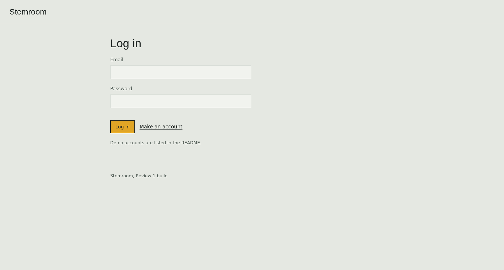 | 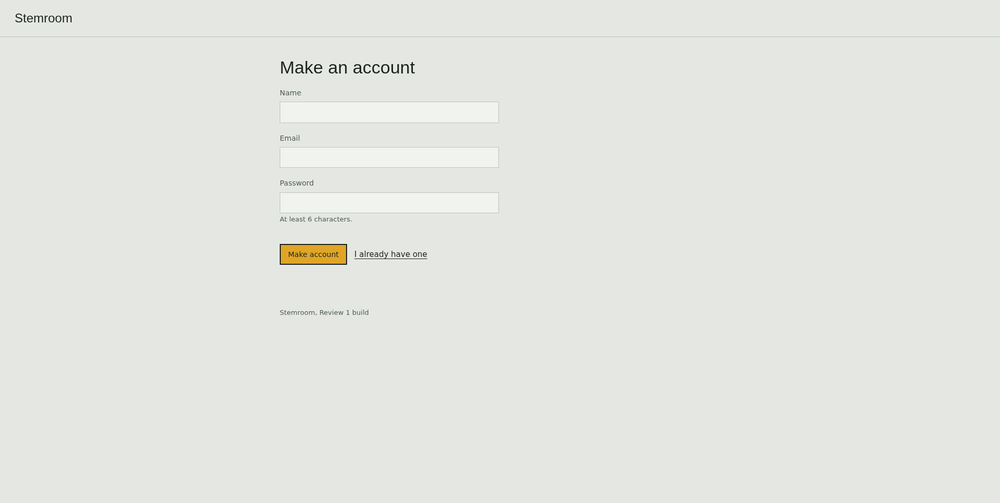 |

### Musician Workspace
| Home Dashboard | Projects List |
| :---: | :---: |
| 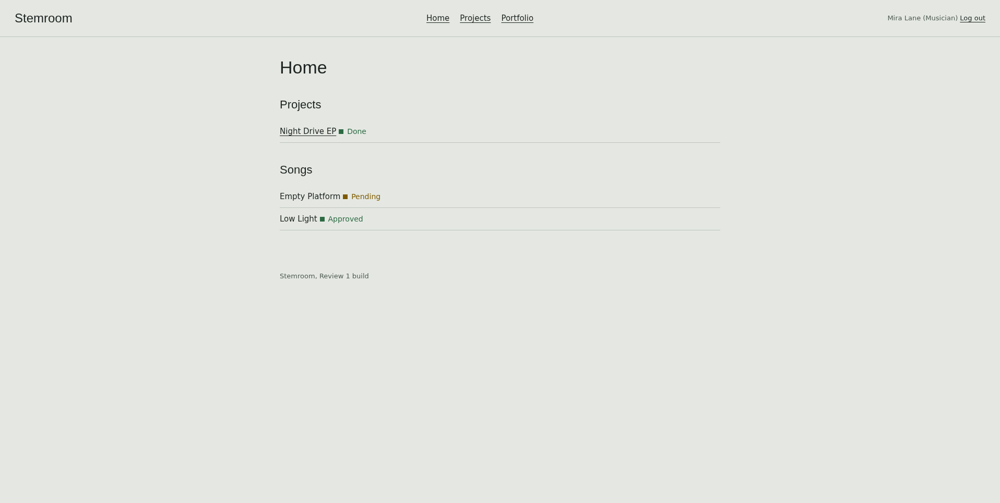 | 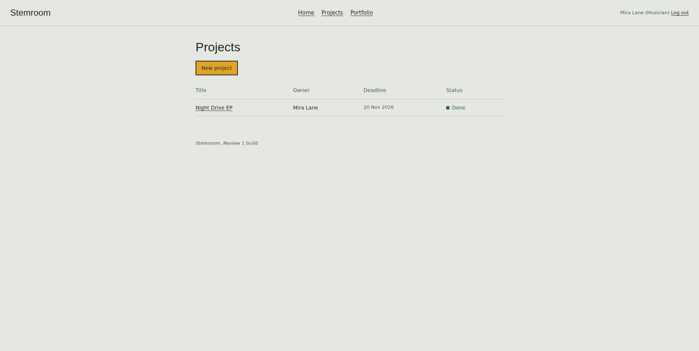 |

| Project Collaboration Details | Create New Project |
| :---: | :---: |
| 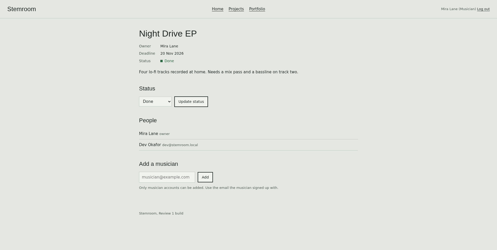 | 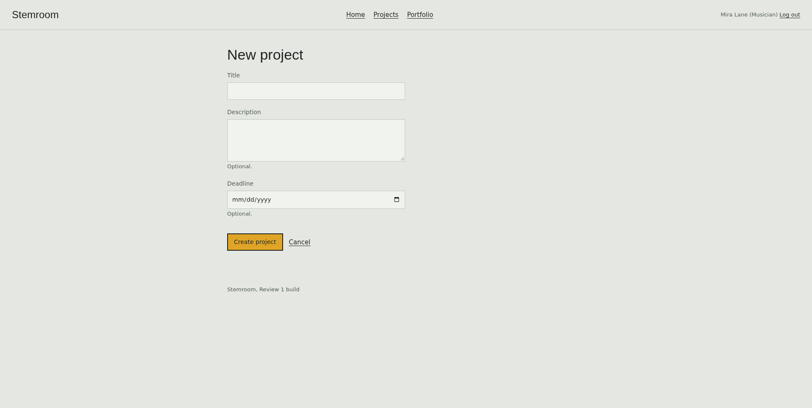 |

| Portfolio & Song Uploads |
| :---: |
| 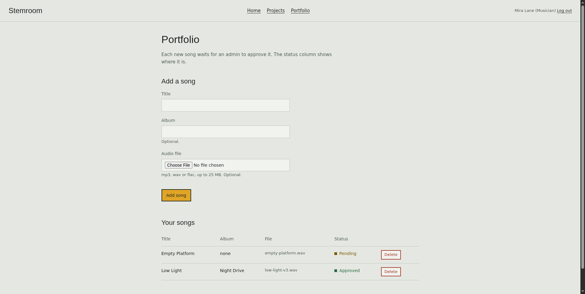 |

### Admin Governance & Moderation
| Admin Home Dashboard | Content Moderation Queue |
| :---: | :---: |
| 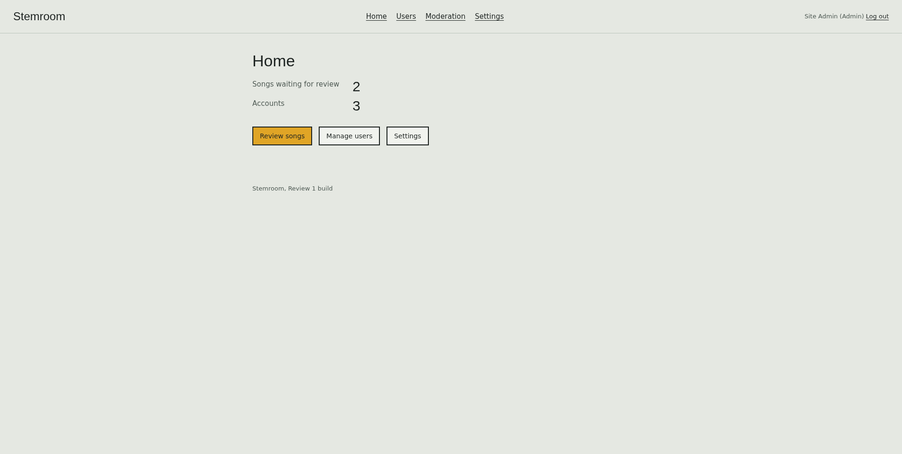 | 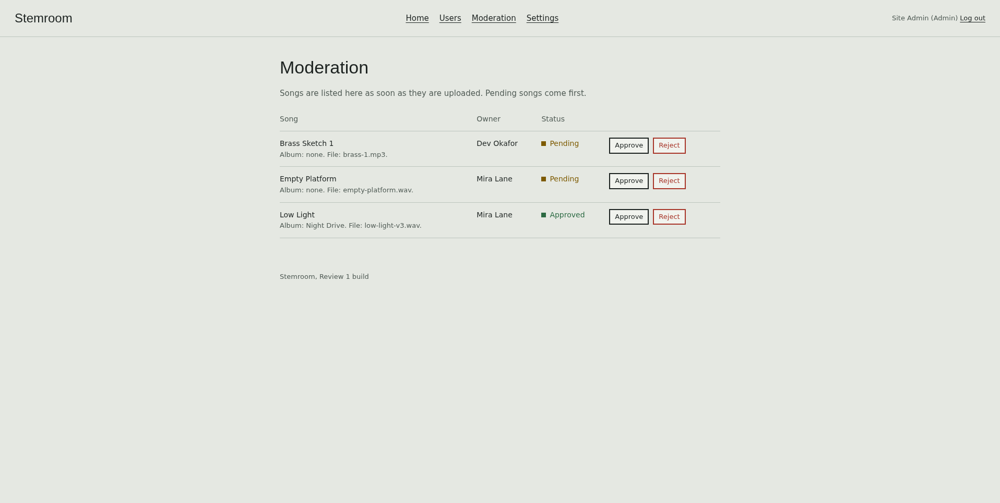 |

| User Account Management | System Settings |
| :---: | :---: |
| 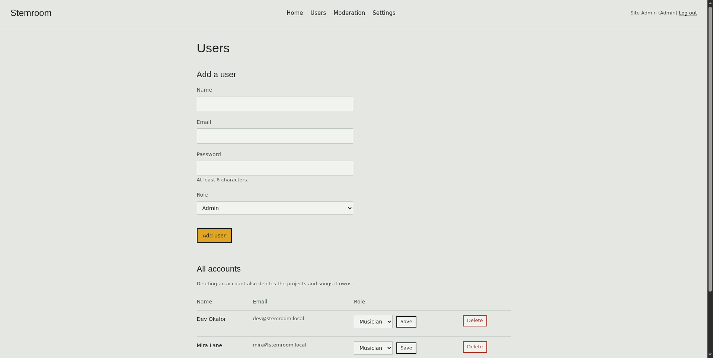 | 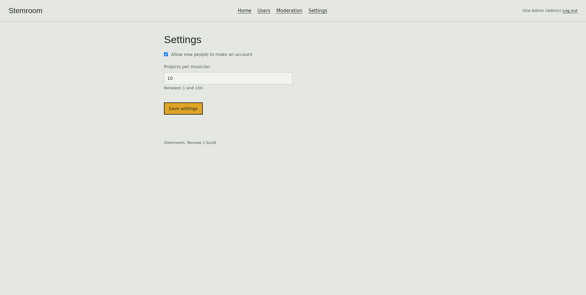 |

## What is left out

Editing a song after upload, playing or downloading audio, sharing songs inside a project, comments, the notification centre and the activity monitor are not in this build. They are planned for Review 2. The reasons are in `docs/REVIEW-1.md`.

## Layout

```
stemroom/
├── pom.xml
├── database/
│   └── schema.sql
├── docs/
│   ├── brand/      logo, banner and social preview
│   ├── DESIGN.md
│   ├── REVIEW-1.md
│   └── TEST-CHECKLIST.md
└── src/main/
    ├── java/com/stemroom/
        ├── dao/        CrudDao, Db, UserDao, ProjectDao, SongDao, SettingDao
        ├── exception/  DataAccessException
        ├── filter/     AuthFilter
        ├── model/      User, Admin, Musician, Project, Song, Role, ProjectStatus, ModerationStatus
        ├── servlet/    AuthServlet, DashboardServlet, ProjectServlet, PortfolioServlet,
        │               AdminUserServlet, AdminModerationServlet, AdminSettingsServlet
        └── util/       PasswordUtil, Validation, WebUtil
    └── webapp/
        ├── index.jsp
        ├── css/style.css
        └── WEB-INF/
            ├── web.xml
            └── views/  JSP pages and partials
```

## How a request moves through the app

A request reaches a servlet. Pages under `/dashboard`, `/projects`, `/portfolio` and `/admin` pass through `AuthFilter` first. The filter checks the login, loads the current user, and blocks musicians from admin pages. The servlet asks a DAO for data. The DAO runs a PreparedStatement against MySQL. The servlet puts the result on the request and forwards to a JSP under `WEB-INF`, which prints the page with JSTL tags.

## Known limits

- Passwords are stored as a salt plus SHA-256. That is fine for learning. A real product would use BCrypt or PBKDF2.
- Forms do not have CSRF tokens yet.
- Each uploaded file is limited to 25 MB. A bigger file gets the error page.
- There is no automated test suite. `docs/TEST-CHECKLIST.md` is the manual list to run before a demo.

## Other docs

- `docs/REVIEW-1.md` has the solution design, database design, rubric mapping and slide outline.
- `docs/DESIGN.md` is the design system and the reasons behind it.
- `docs/TEST-CHECKLIST.md` lists the manual checks.
- `docs/brand/` holds the logo, banner and social preview images.
