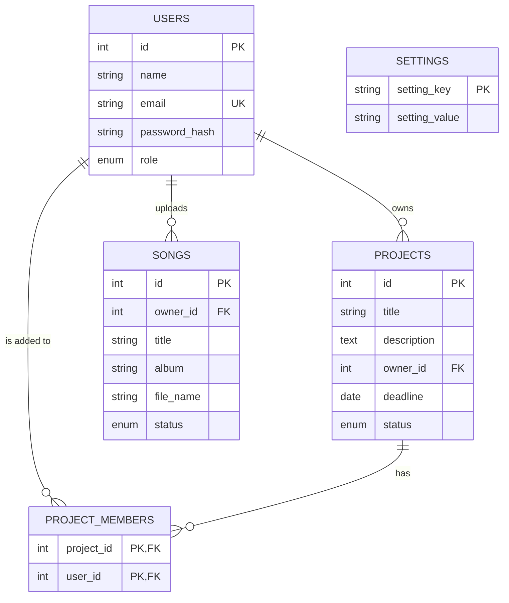

# Review 1: solution design

**Team Name:** ByteForce  
**Members:**
- Om Singh
- Aryan Sharma
- Adi

This document holds the design work for Review 1. Use it for the written part of the submission and as the source for the slides.

## 1. Problem understanding

Musicians who work in different places need one shared place for their songs and their projects. Without it, files move around in chat and nobody is sure which version is current or when the work is due.

The brief defines two user types. The admin manages users, content and system settings. The musician collaborates on projects, shares and edits music files, and keeps a portfolio.

The main design decision follows from the brief. Uploaded songs are not public until an admin approves them, so the platform needs moderation as a real step, not an afterthought.

## 2. Scope for Review 1

The Review 1 brief asks for project structure, database design and connectivity, UI design, aesthetics and responsiveness. This build covers each of those. It keeps the features to the smallest set that shows each one working. Section 3 says which brief items are not built yet.

## 3. Features against the brief

| Brief item | Status | Where it lives |
| --- | --- | --- |
| Admin: user management | Built: add, change role, delete | `AdminUserServlet`, `admin/users.jsp` |
| Admin: content moderation | Built: approve or reject songs | `AdminModerationServlet`, `admin/moderation.jsp` |
| Admin: system settings | Built: sign-ups on or off, projects per musician | `AdminSettingsServlet`, `admin/settings.jsp` |
| Admin: activity monitoring | Planned for Review 2 | not built |
| Musician: project collaboration | Built: create, list, add members, change status | `ProjectServlet`, `projects/*.jsp` |
| Musician: share and edit music files | Partly built: upload and delete. Edit and sharing come in Review 2 | `PortfolioServlet`, `portfolio.jsp` |
| Musician: manage portfolio | Built: add and delete songs | `PortfolioServlet`, `portfolio.jsp` |
| Musician: notification center | Planned for Review 2 | not built |
| Dashboards | Built: one page, content depends on the role | `DashboardServlet`, `dashboard.jsp` |

## 4. Architecture

The app follows the usual servlet layers, kept small:

```
Browser
   |
   v
AuthFilter        checks the session and the role
   |
   v
Servlet           reads the request, checks input, chooses the page
   |
   v
DAO               JDBC with PreparedStatement, one class per table
   |
   v
MySQL 8

Servlet -> JSP (WEB-INF/views) -> HTML and CSS
```

Each layer is a package. `model` holds plain objects. `dao` holds the SQL. `servlet` handles HTTP. `filter` handles access. `util` holds helpers. `webapp` holds the JSP pages and the CSS.

No framework sits on top of this. The rubric asks for servlets and JDBC, and a framework would hide exactly the parts being marked.

## 5. Database design



Decisions behind the design:

- The owner is stored once, in `projects.owner_id`. The members table only lists people who were added, so the owner cannot appear twice.
- `project_members` is a join table. A project has many musicians and a musician joins many projects, so the two sides need a table between them.
- Every new song starts as `PENDING`. Moderation moves it to `APPROVED` or `REJECTED`.
- Settings are key and value rows, so a new setting does not need a schema change.
- Foreign keys use `ON DELETE CASCADE`. Deleting an account removes what it owns. The admin page says so next to the delete button.
- Emails are unique and stored in lower case, so `Mira@X.com` and `mira@x.com` are one account.

## 6. Core Java concepts

| Concept | Where it is used |
| --- | --- |
| Inheritance | `User` is extended by `Admin` and `Musician` |
| Polymorphism | `canModerate()` and `getRole()` are overridden. The filter, the header and the dashboard call them without checking the type |
| Abstract class | `User` cannot be created directly. `User.create()` picks the subclass |
| Interface | `CrudDao<T>` is implemented by `UserDao`, `ProjectDao` and `SongDao` |
| Generics | `CrudDao<T>`, and `Db.query` with the `RowMapper<T>` type |
| Collections | `List` for query results, `Optional` for "not found" so the code never returns null for a row |
| Enums | `Role`, `ProjectStatus` and `ModerationStatus` each have a label and a `parse` method for form input |
| Exceptions | `DataAccessException` wraps `SQLException`. Bad input gets a 400, 403 or 404 response, not a crash |
| Streams | The admin dashboard counts pending songs |
| Try-with-resources | Every connection, statement and result set is closed automatically |

## 7. JDBC

`Db` is the only class that opens connections. It reads the database address and login from environment variables, so the password is not in the code. Every statement is a `PreparedStatement`, so values are passed as parameters and never added to the SQL text.

Inserts use `RETURN_GENERATED_KEYS`, so the new row's id comes back without a second query. Owner names come from a join, so list pages need one query, not one per row.

The seed data in `schema.sql` builds password hashes with MySQL's `SHA2` function. The hash format matches `PasswordUtil`, so the demo logins work straight after the script runs.

## 8. Servlets and web integration

- Servlets are mapped with annotations. Related paths share one servlet, such as `/projects`, `/projects/new` and `/projects/detail`.
- `AuthFilter` covers every page that needs a login. It also blocks musicians from `/admin`.
- The session holds only the user id. The filter loads the user on each request, so a role change applies on the next page load.
- A new session id is created at login, so an old session id cannot be reused.
- Successful changes redirect (post, redirect, get). Failed changes forward back to the form with a message, so the user keeps what they typed.
- Song uploads use `@MultipartConfig` with a size limit and a file type check.
- The pages are JSP under `WEB-INF`, so a browser cannot open them directly. They use JSTL tags and no scriptlets. All user text is printed with `c:out`, which escapes it.
- `web.xml` maps the error codes to one error page.

## 9. Rubric mapping

The Review 1 guidelines have two rubrics: Rubric A for GUI-based projects and Rubric B for web-based projects. This project is web-based and follows Rubric B. The guidelines do not yet publish the Rubric B criteria, so this section maps the repo to the areas the brief names and does not assign marks.

| Area | Evidence in the repo |
| --- | --- |
| Problem understanding and solution design | This document, sections 1 to 5, and the README |
| Core Java concepts | Section 6, the `model` and `dao` packages |
| Database integration (JDBC) | `database/schema.sql`, the `dao` package, sections 5 and 7 |
| Servlets and web integration | The `servlet` and `filter` packages, `web.xml`, section 8 |

The guidelines also ask for well-commented, modular code with a README. The code has comments on each class and on the parts that are not obvious. The README covers setup, requirements and running the project.

## 10. Known limits

- Passwords use a salt and SHA-256. That is fine for learning, but BCrypt or PBKDF2 would be the right choice for a real product.
- Forms have no CSRF tokens.
- Songs cannot be edited or downloaded yet.
- Uploaded files live on the server disk, not in the database.
- The admin dashboard shows counts only. There is no activity log.
- The app has no automated tests. The manual checklist is in `TEST-CHECKLIST.md`.

## 11. Plan for Review 2

- Edit song details and replace the file.
- Download or play a song.
- Share songs inside a project and add comments to them.
- Add the notification center and the activity monitor.
- Move password hashing to BCrypt and add CSRF tokens.

## 12. Slide outline

1. Title, team members and the project name.
2. The problem in one sentence, and who has it.
3. The two user types and what each one does.
4. What Review 1 covers and what it leaves for Review 2.
5. Architecture diagram: filter, servlet, DAO, MySQL, JSP.
6. Database design: the ER diagram and the three decisions behind it.
7. A JDBC example: one query, the `PreparedStatement` and the mapping to a model.
8. Screens: login, musician home, project detail, admin moderation.
9. Design choices: palette, type pairing, and what was left out on purpose.
10. Done, not done, and the Review 2 plan.
